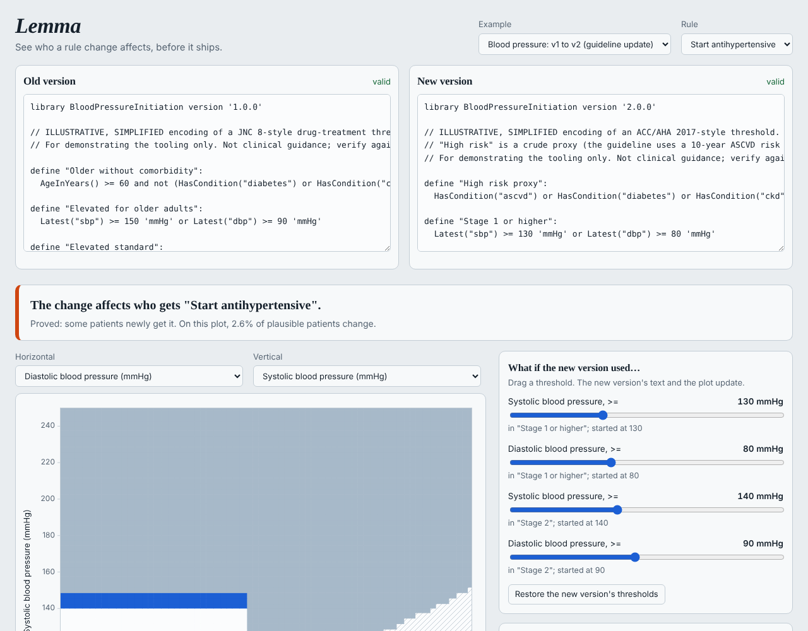

# Lemma

[](https://github.com/Sandeepsrinivasan-14/lemma/actions/workflows/ci.yml)

**Verify and diff clinical decision logic.** Lemma takes rules written in a small CQL-like language and answers, with proof rather than sampling:

- *What changed?* Given two versions of a rule, is there a patient they treat differently? Lemma returns the smallest such patient (a "witness"), or proves there is none.
- *Is it safe?* Does a rule ever break a stated invariant ("never recommend metformin when eGFR < 30")? Proof or a counterexample patient.
- *What if data is missing?* Which single missing measurement silences a rule, or makes it fire without evidence?
- *Who is affected?* Cohort impact with confidence intervals, split by sex and age band.
- *How fragile is it?* Which patients flip decision within normal measurement noise?

It runs as a CLI (usable as a CI gate), a Python library, and a local web UI with a zone plot and live threshold sliders.



## Quick start

```bash
pip install -e ".[dev]"
lemma diff examples/rules/bp_initiation_v1.cql examples/rules/bp_initiation_v2.cql --rule "Start antihypertensive"
lemma verify examples/rules/bp_initiation_v2.cql examples/invariants/safety.lemma
lemma serve            # http://127.0.0.1:8000
pytest -q
```

`lemma diff` exits 1 when versions differ, `lemma verify` exits 1 when an invariant is broken, so both can gate a pull request.

Example output (guideline-style change, v1 to v2):

```
GAINED (fires only under the new version): old=null, new=true; smallest witness found:
    age 60, sex female
    sbp: 140 mmHg
    not recorded: dbp, ...
```

The old version was *undecided* for this patient (diastolic pressure missing) while the new one recommends treatment. That is the kind of behaviour change a hand-written test suite rarely catches: the 15 boundary tests generated from v1 all still pass on v2.

## How it works

1. **Language.** A deliberately small CQL-like subset (`Latest`, `Delta`, `Ratio`, `AgeInYears`, `HasCondition`, `OnMedication`, `Coalesce`, comparisons with units, `and/or/not`, `is null`). Own parser and checker: units must match (with schema conversions such as umol/L to mg/dL), unsupported constructs are rejected with an explanation.
2. **Semantics.** Three-valued (Kleene) logic, so missing data is first-class. A reference interpreter uses exact rationals.
3. **Encoding.** Rules are compiled to Z3. Observations live on the schema's measurement grid, with at most one prior value per trend observation. Booleans are (true, false) pairs, numbers are (null, value).
4. **Witnesses are replayed.** Every counterexample from the solver is re-evaluated by the independent interpreter; a disagreement raises `EncodingMismatch` instead of reporting a wrong answer.
5. **Minimal witnesses.** `z3.Optimize` minimises how many facts a witness needs, then its distance from a typical patient, so examples are small and plausible. They export as FHIR R4 bundles.

Details of the encoding and its guarantees: [docs/METHOD.md](docs/METHOD.md).

## LemmaBench (results in `results/RESULTS.md`)

201 mutants of 6 example rule libraries (threshold nudges, flipped boundaries, reversed comparisons, dropped conditions, and/or swaps, negated flags, unit mix-ups, missing-as-normal):

| Method | Seeded bugs found |
| --- | --- |
| **Lemma** | **186 / 186** (and proved 15 mutants equivalent) |
| 2000 cohort-sampled patients | 177 / 186 (95.2%) |
| 200 uniform random patients | 140 / 186 (75.3%) |
| 200 cohort-sampled patients | 128 / 186 (68.8%) |
| boundary tests from the original | 94 / 186 (50.5%) |

Other results: encoding vs interpreter agreed on 122,268 evaluations across 207 libraries (0 mismatches); median diff well under a second.

### Checked against the official HL7 CQL toolchain (E10)

`lemma official <rules>` exports Lemma rules to real CQL, compiles them with the official translator (`@cqframework/cql` 5.4.0) and runs them in the `cql-execution` 3.3.2 engine on the same patients as Lemma's interpreter (Node.js needed: `npm install --prefix tools/official`).

- 207 libraries (6 gold + 201 mutants): **all 207 compile** with the official translator.
- 235,518 true/false/null definition results compared: **26 disagreements**, all in `aki_alert` and its mutants, all at an exact boundary: the JS engine computes `1.2 - 0.9` as 0.2999999999999999 (IEEE floats), so "rise of 0.3" is false there, while Lemma's exact rationals say true. Three-valued logic (missing data) agreed everywhere. I have not run the Java engine, which uses `BigDecimal` and likely matches Lemma; treat that as untested.

**Read these honestly.** Mutants come from my own operators, so rates describe this benchmark. Lemma "finds 100%" partly because it is exact within its model; the interesting numbers are how far the cheaper baselines fall short and that equivalent edits are *proved* harmless. Cohorts are synthetic.

## Limits (please read)

- **A CQL-*like* subset, not full CQL.** It has its own parser and checker, so CQL libraries from the wild will mostly not parse. Within the subset, Lemma rules *are* checked against the official toolchain (see "Checked against the official HL7 CQL toolchain" above): they export to real CQL that the official translator accepts. The comparison uses a parameter-based export, not the FHIR data model.
- **Bounded domain.** Proofs hold for patients on the schema's measurement grid and plausible ranges, with at most one prior value per trend observation. Anything outside that model is outside the guarantee.
- **Example rules are illustrations**, simplified from the shape of public guidelines. They are not clinical guidance, and the invariant sources are placeholders to verify.
- **Synthetic cohort.** The bundled generator is not validated against real populations. Impact and equity numbers on it describe the generator. Use `--cohort file.csv` to plug in your own data; equity output is descriptive, not a fairness conclusion.
- **FHIR export** passes a structural check only, not HL7 validation.
- **The UI has no authentication.** It binds to localhost; do not expose it or paste real patient data into it.
- Research prototype. Not a medical device and not for clinical use.

## Layout

```
src/lemma/lang/      lexer, parser, checker, printer
src/lemma/interp.py  reference interpreter (exact, Kleene)
src/lemma/smt.py     Z3 encoding
src/lemma/analyses/  diff, invariants, missing data, impact, robustness, test generation, cross-check
src/lemma/bench/     mutant generator and experiments
src/lemma/web/       static UI;  server.py  FastAPI;  cli.py  command line
examples/            schema, illustrative rules, invariants
```

MIT licence.
